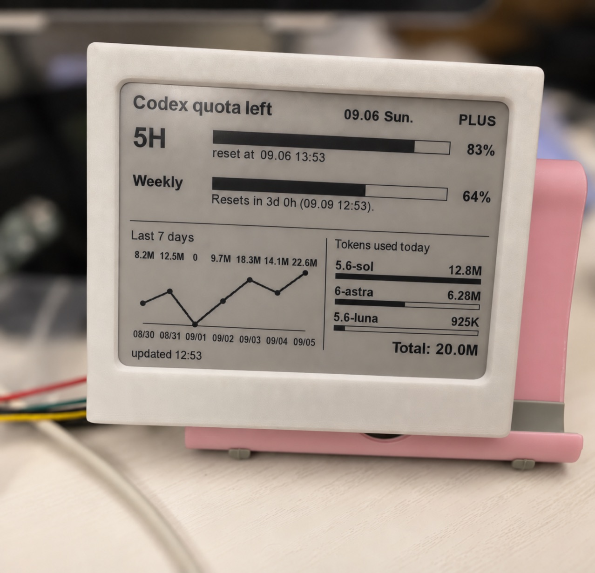

# codex-usage-epd

[](https://github.com/hunterMG/codex-usage-epd/actions/workflows/ci.yml)
[](https://pypi.org/project/codex-usage-epd)
[](https://pypi.org/project/codex-usage-epd)

**Your OpenAI Codex usage, always on display.**

`codex-usage-epd` pushes your Codex usage — remaining quota and token totals — to
a 4.2" 400×300 three-colour e-paper panel over Bluetooth LE. It works with
displays running the [EPD-nRF5](https://github.com/tsl0922/EPD-nRF5) firmware.



## ✨ What you get

- **Quota at a glance** — 5-hour and weekly windows with used/remaining
  percentages and reset times.
- **Today's token usage** — a total across all models, plus your top three models
  shown as bars proportional to the most-used model.
- **Optional 7-day history** — a compact line chart for the seven completed
  calendar days before today.
- **Credits balance** when your plan includes one.
- **Red alert bars** when remaining quota drops below your warning threshold.
- **Set-and-forget updates** — refresh automatically on a macOS launchd schedule.

## 🧰 Requirements

- macOS with Bluetooth LE support
- Python 3.10 or newer
- A ChatGPT/Codex login on the same Mac (`~/.codex/auth.json` with
  `tokens.access_token`)
- A 4.2" 400×300 black/white/red panel with an SSD1683/SSD1619 driver and model
  ID `0x02`

## 📦 Install

Pick whichever Python tool you already use:

```sh
# pipx — recommended for command-line applications
pipx install codex-usage-epd

# uv
uv tool install codex-usage-epd

# pip
pip install codex-usage-epd
```

To install from source instead:

```sh
git clone https://github.com/hunterMG/codex-usage-epd.git
cd codex-usage-epd
pipx install .        # or: uv tool install . / pip install .
```

Upgrade later with the matching command (`pipx upgrade codex-usage-epd`,
`uv tool upgrade codex-usage-epd`, or `pip install --upgrade codex-usage-epd`).

## 🚀 Quick start

1. **Create a configuration file**

   ```sh
   codex-usage-epd --init
   ```

   The command prints the config path. When installed as a package it writes to
   `~/.config/codex-usage-epd/codex_usage_epd.yaml`; in a source checkout it
   writes to `config/codex_usage_epd.yaml`.

2. **Point it at your display** — open the config and set `ble.device` to your
   panel's MAC address or Bluetooth name, or leave it as `auto` to scan for
   `NRF_EPD`.

3. **Try it without hardware**

   ```sh
   codex-usage-epd --selftest    # sample data, no network or display needed
   codex-usage-epd --dry-run     # live data, saves preview.png
   ```

4. **Send it to the panel**

   ```sh
   codex-usage-epd --once
   ```

### 🤖 Let a coding agent install it

Paste this prompt into Codex or another coding agent:

```text
Install https://github.com/hunterMG/codex-usage-epd on this computer. Read the
README first, check that the prerequisites are available, clone the repository
into an appropriate user directory, install it with an appropriate Python tool,
generate the configuration file, and run the self-test. Do not print, copy, or
modify my Codex authentication token. Tell me what configuration still needs my
input, and ask for confirmation before installing or starting the launchd
background agent.
```

## 🕹️ Commands

| Command | Description |
| --- | --- |
| `codex-usage-epd --init` | Generate a config file from the template |
| `codex-usage-epd --selftest` | Render sample data and verify encoding without network or display |
| `codex-usage-epd --dry-run` | Fetch live usage and render `preview.png` without Bluetooth |
| `codex-usage-epd --probe` | Connect to the display and print its config and MTU |
| `codex-usage-epd --test-screen` | Clear and refresh the panel to check the firmware path |
| `codex-usage-epd --once` | Fetch, render, and push to the display once |
| `codex-usage-epd --loop` | Push every `schedule.interval_minutes` forever |

Options can be combined with the commands above:

| Option | Description |
| --- | --- |
| `--config <path>` | Use a specific YAML config instead of the default |
| `--force` | With `--init`, overwrite an existing config |
| `--font <path>` | Override `render.font` |
| `--sample` | Use synthetic sample data instead of fetching usage |
| `--show-history` / `--no-show-history` | Override `render.show_history` |
| `--debug` | Dump the raw usage response to `tmp/usage_dump.json` |

Without `--config`, the config is loaded from the checkout's
`config/codex_usage_epd.yaml`, then
`~/.config/codex-usage-epd/codex_usage_epd.yaml`, then the bundled template.

## ⚙️ Configuration

Create a config with `codex-usage-epd --init`, then edit the generated YAML.
The most useful settings are:

| Key | Default | Description |
| --- | --- | --- |
| `display.width` / `display.height` | `400` / `300` | Panel resolution in pixels |
| `display.model_id` | `0x02` | EPD model ID (`0x02` for SSD1619 400×300 BWR) |
| `display.sleep_after_push` | `false` | Send SLEEP after pushing. Keep `false`; sleeping early aborts the refresh |
| `ble.device` | `auto` | `auto`, a MAC address, or a Bluetooth name substring |
| `ble.mtu` | `247` | Bluetooth MTU |
| `ble.scan_timeout` | `10` | Seconds per scan attempt |
| `ble.scan_retries` | `3` | Scan attempts before giving up on missed advertisements |
| `ble.interleave` | `50` | Writes per response acknowledgement (matches the web client) |
| `ble.pacing_ms` | `0.0` | Delay between writes (`0.0` is back-to-back) |
| `ble.hold_after_refresh` | `20` | Seconds to stay connected while the panel refreshes |
| `ble.patch_wakeup_pin` | `true` | Keeps the panel advertising after its sleep timeout |
| `ble.slot` | `0` | Image slot for slot-based firmware; `auto` picks a free slot, `-1`/`none` disables `SET_SLOT` |
| `ble.stop_slideshow` | `true` | On slot firmware, switch to picture mode after each push so an active slideshow stops |
| `codex.auth_file` | `~/.codex/auth.json` | Location of the OAuth tokens |
| `codex.timeout` | `15` | Usage request timeout in seconds |
| `render.font` | auto | Path to a `.ttf` font; empty means auto-detect |
| `render.warn_threshold` | `20` | Remaining percentage that turns a bar red |
| `render.preview` | `preview.png` | Filename for the rendered preview |
| `render.show_history` | `false` | Show the "Last 7 days" chart |
| `schedule.interval_minutes` | `60` | Interval used by `--loop` |

`codex` also reads `chatgpt_base_url` from `~/.codex/config.toml` when set.

## ⏰ Run automatically with launchd

The launchd agent runs `codex-usage-epd` from `.venv/bin/` inside a source
checkout. If you have not already done so, create that environment and install
the project into it:

```sh
python3 -m venv .venv
.venv/bin/pip install .
./deploy/install.sh
```

The installer fills in the checkout path, writes
`~/Library/LaunchAgents/com.codex-usage-epd.plist`, and starts the agent. It
refreshes the display every 60 minutes. To remove it later:

```sh
launchctl bootout gui/$(id -u)/com.codex-usage-epd
rm ~/Library/LaunchAgents/com.codex-usage-epd.plist
```

## 🔒 Privacy

Your Codex tokens are read locally from `~/.codex/auth.json` and are never
logged, printed, or committed. Usage data is fetched directly from OpenAI; no
third-party service is involved.

## 🩺 Troubleshooting

- **Display not found** — make sure the panel is powered and nearby. Try
  `codex-usage-epd --probe`; if scanning still fails, set `ble.device` to the
  panel's MAC address or Bluetooth name instead of `auto`.
- **The screen stays blank or refreshes partway** — keep the panel connected to
  USB power and leave `display.sleep_after_push: false`. You can also increase
  `ble.hold_after_refresh`.
- **Authentication errors** — sign in to Codex again on this Mac and confirm
  `~/.codex/auth.json` exists, or update `codex.auth_file`.
- **Token usage is missing** — token totals are read from
  `$CODEX_HOME/sessions` (or `~/.codex/sessions`) and `archived_sessions`.
  Confirm those directories contain local Codex session logs.
- **Colors look wrong in the preview** — the panel has no greys, only black,
  white, and red. Light grey text intentionally renders as white.

## 🛠️ Development

Development notes, project layout, and preview checks are in
[docs/development.md](docs/development.md).

## 📄 License

GNU AGPL v3.0 or later — see [LICENSE](LICENSE).
